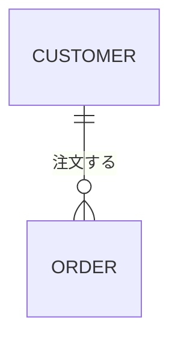
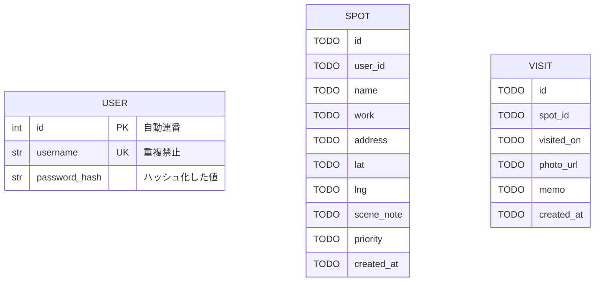
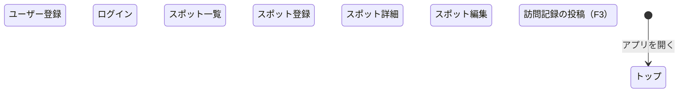
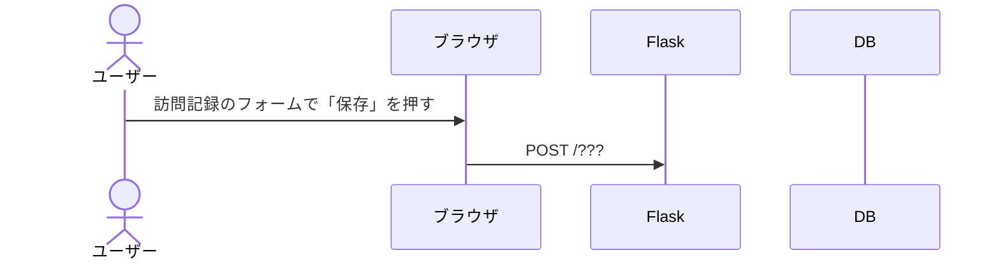

# ALTERNATIVE 設計図（Mermaid）

Mermaidは、文字で書くと図になる記法。キーボードだけで描ける。
`docs/requirements.md` の 3-2（画面遷移図）、3-3（データ）、4（内部設計）に使う。

## 見方・描き方

| 場所 | やり方 |
|---|---|
| GitHub | このファイルを開くと、下の `mermaid` ブロックがそのまま図として表示される |
| ブラウザ（インストール不要） | https://mermaid.live を開いて、`mermaid` ブロックの中身を左側に貼る。右側に図が出る |
| VS Code | 拡張「Markdown Preview Mermaid Support」を入れて、このファイルをプレビュー（Ctrl+Shift+V） |

- `%%` で始まる行はコメント。図には出ない。
- 図が出ずにエラーになったら、直前に変えた行を見直す。

---

## ① E-R図：USER・SPOT・VISIT

### 用語

| 印 | 名前 | 意味 |
|---|---|---|
| `PK` | 主キー | その行を1つに決める列。同じ値は2つとない |
| `FK` | 外部キー | 別のテーブルの行を指す列。指す先の主キーの値を入れる |
| `UK` | 一意キー | 同じ値を2回入れられない列（主キーではないもの） |

### 線の記号（多重度）

```text
左側  右側   意味
||    ||    ちょうど1
|o    o|    0か1
}o    o{    0以上
}|    |{    1以上
```

`--` の左に左側の記号、右に右側の記号を付ける。下の例は「顧客1人に、注文が0件以上」。
1対多の線では、**外部キーを持っている側が「多」** になる（この例なら、注文が顧客の外部キーを持つ）。



### 1行の書き方

- `型 列名 キー "コメント"` の順（キーとコメントは無くてもいい）
- 型：`int` `str` `float` `datetime` `date`（`CLAUDE.md` のテーブル定義書に合わせる）
- 主キーかつ外部キーなら `PK, FK` のように並べる
- NULL可には専用の記号がないので、コメントに `"NULL可"` と書く

### 図

USERはお手本として完成させてある。SPOTとVISITの `TODO` を型に変えて、キーとコメントを足す。
最後に、関係の行の `??` を記号に変えて、行頭の `%%` を消す。

順番：**SPOTを描く → `app.py` の `class Spot` と見比べる → VISITを描く。**



---

## ② 状態マシン図：画面の流れ

UMLでは、画面遷移図を状態マシン図で描く。

- 黒丸 `[*]` が始まり、箱が画面、矢印が画面の移動
- `A --> B : 何をしたら移るか` の形で書く
- `docs/screens.md` の「終わったらどこへ」の列が、そのまま矢印になる
- **ログアウトと削除は画面を持たない**（押すと処理だけして別の画面へ飛ぶ）。だから箱にしないで、矢印の文字にする。書き方の例：`spots --> login : ログアウトを押す`



- F2までの部分は、今のアプリを実際に触って、どこからどこへ行けるかも確かめる。行けない画面があったら、そこが導線の足りないところ
- F3の矢印（`visit_new` への行き帰り）は、設計として決める

---

## ③ シーケンス図：訪問記録を保存するとき

ひとつのルートの中で、誰が誰に何を頼むかを時間の順に並べる。`docs/requirements.md` の 4（内部設計）の「AだからB」を図にしたもの。

- 縦の線が登場人物、横の矢印がやりとり。上から下へ時間が進む
- 実線の矢印 `->>` は「頼む」、点線の矢印 `-->>` は「返事」
- `docs/screens.md` の「送ったとき（POST）」の列の中身が、Flask と DB のあいだの矢印になる



条件で流れが分かれるときは、`alt` / `else` / `end` で囲む。「他人のスポットだったら？」を描くときに使う。

```text
alt 条件A
    （条件Aのときのやりとり）
else 条件B
    （条件Bのときのやりとり）
end
```
